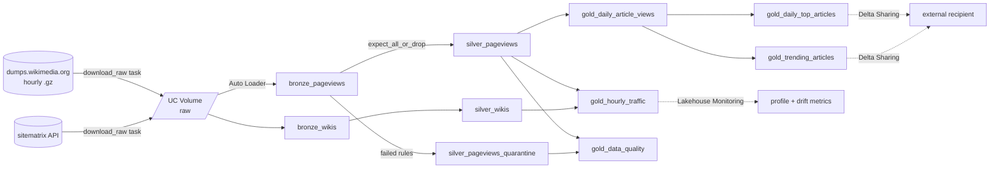

# Wikipedia Lakehouse

A production-style Databricks lakehouse over [Wikimedia's hourly pageview dumps](https://dumps.wikimedia.org/other/pageviews/). The dumps record how often every page on every Wikimedia wiki was viewed, about 7 million rows per hour. The project covers incremental ingestion, a medallion pipeline with enforced data quality, monitoring, sharing, and CI/CD. Everything is deployed as code with Databricks Asset Bundles.



## What it shows

| Capability | Where |
| --- | --- |
| Infrastructure as code: schema, volume, pipeline and job | `databricks.yml`, `resources/` |
| Idempotent ingestion that only fetches new hours, with a polite User-Agent | `src/ingest/download_pageviews.py` |
| Incremental loading of gzipped text with Auto Loader | `transformations/bronze.py` |
| Declarative pipeline (Lakeflow) with expectations and quarantine | `transformations/silver.py` |
| Window-function analytics (top N, trending vs. trailing baseline) as materialized views | `transformations/gold.py` |
| Unit-tested, ANSI-safe transformation logic, no cluster needed | `utilities/transforms.py`, `tests/` |
| Time-series drift monitoring | `src/monitoring/setup_monitor.py` |
| Delta Sharing to non-Databricks consumers | `sql/delta_sharing.sql` |
| Test, validate and deploy from GitHub Actions | `.github/workflows/ci.yml` |
| Plain-English questions over the gold tables (AI/BI Genie), with instructions and example SQL | `resources/wiki.genie.yml` |
| Lineage, from raw file to gold column | automatic in Unity Catalog (Catalog Explorer → Lineage) |

## The data

Each dump line is `domain_code page_title views 0`. The hour comes from the file name, for example `pageviews-20261025-120000.gz`. Silver decodes `domain_code` into three columns:

| domain_code | language | project | access |
| --- | --- | --- | --- |
| `en` | en | wikipedia | desktop |
| `en.m` | en | wikipedia | mobile |
| `de.m.voy` | de | wikivoyage | mobile |
| `commons.m` | commons | wikimedia | desktop (for *.wikimedia.org the first `.m` is the project, not mobile) |
| `www.wd` | www | wikidata | desktop |

`is_content` marks reader-facing articles. It excludes `Main_Page`, `Special:`, `User:`, `File:` and similar namespaces, so the top and trending tables show real articles. The namespace list is in English, so the filter is exact for English wikis and approximate elsewhere.

## Gold tables

| Table | What it answers |
| --- | --- |
| `gold_daily_article_views` | Views per article per wiki per day, split into desktop and mobile |
| `gold_daily_top_articles` | Top 100 articles per wiki per day |
| `gold_trending_articles` | Articles with at least 5× their trailing 7-day average views (and at least 1,000 views). Days with no views count as 0 |
| `gold_hourly_traffic` | Views, mobile share and approximate distinct pages per wiki per hour, with language names |
| `gold_data_quality` | Lines kept vs. quarantined per day, and failures per rule |

## Quickstart

1. **Get a workspace.** [Databricks Free Edition](https://www.databricks.com/learn/free-edition) works. Its default catalog is `workspace`, which is this bundle's default.
2. **Install and authenticate the CLI:**
   ```sh
   winget install Databricks.DatabricksCLI      # or: brew install databricks/tap/databricks
   databricks auth login --host https://<your-workspace>.cloud.databricks.com
   ```
3. **Set your contact info.** Wikimedia [requires a User-Agent](https://foundation.wikimedia.org/wiki/Policy:Wikimedia_Foundation_User-Agent_Policy) that identifies you. Edit the `user_agent` default in `databricks.yml` to include your email or repo URL.
4. **Deploy and run your dev copy:**
   ```sh
   databricks bundle validate
   databricks bundle deploy                          # creates dev_<you>_wikipedia schema, volume, pipeline, job
   databricks bundle run wiki_job                    # yesterday's 24 hours: download -> pipeline -> monitor
   ```
5. **Backfill for trending.** `gold_trending_articles` needs history to compare against. Load at least 8 days once:
   ```sh
   databricks bundle run wiki_job --params days=last:8
   ```

**Data volume:** each day is 24 files, about 1 GB compressed and about 160 million rows. If you hit Free Edition limits, load fewer days. Single hours also work, for example `days=2026-10-25T12`.

### If the download task can't reach the internet

Some workspaces, including Free Edition, restrict outbound network access from serverless compute. If `download_raw` fails to connect, download on your machine and upload:

```sh
python src/ingest/download_pageviews.py --days last:1 --dest ./data --user-agent "wikipedia-lakehouse/0.1 (you@example.com)"
databricks fs cp -r ./data dbfs:/Volumes/workspace/dev_<you>_wikipedia/raw --overwrite
```

Then run the pipeline directly with `databricks bundle run wiki_pipeline`. The job's download task needs internet access even when the files are already uploaded, because it always refreshes the wiki list.

## Data quality

Silver enforces the rules in `QUALITY_RULES` (`utilities/transforms.py`). Rows that fail any rule are dropped from `silver_pageviews` and written to `silver_pageviews_quarantine`. Because the quarantine predicate is the exact complement of the rules, every bronze line ends up in exactly one of the two tables.

| Rule | Catches |
| --- | --- |
| `well_formed` | lines without exactly 4 space-separated fields |
| `known_hour` | files whose name doesn't encode an hour |
| `positive_views` | non-numeric or zero view counts |
| `has_title` | empty or `-` titles |
| `valid_domain` | empty or malformed domain codes |

`plausible_hourly_views` (under 5M views per page per hour) is warn-only. It shows up in the pipeline event log as a bot-spike signal without dropping data.

On a real hour (2026-10-25 12:00 UTC), 1,461 of 6,679,030 lines (0.022%) were quarantined. All of them had empty domain codes or `-` titles.

## Local development

```sh
uv sync
uv run ruff check .
uv run pytest
```

Tests run PySpark locally and need **Java 17 or 21**. Newer JDKs might not start Spark. If `java -version` reports something newer, point `JAVA_HOME` at a supported JDK before running `pytest`.

## CI/CD

`.github/workflows/ci.yml` runs on every PR and every push to `main`:

1. **test**: ruff and pytest on Java 17
2. **validate**: `databricks bundle validate -t prod`
3. **deploy**: `databricks bundle deploy -t prod` (only on push to `main`, gated by the `prod` GitHub environment)

Add these repository secrets: `DATABRICKS_HOST` and `DATABRICKS_TOKEN` (a personal access token). For a real production setup, deploy as a service principal: set `run_as` in the `prod` target and use `DATABRICKS_CLIENT_ID` and `DATABRICKS_CLIENT_SECRET` (OAuth M2M) in place of the token.

## Next steps

- Build an AI/BI dashboard on the gold tables and add it to the bundle as a `dashboards` resource.
- Flag likely bot traffic, such as pages with extreme desktop-only spikes, and exclude it from trending.
- Join with the [clickstream dumps](https://dumps.wikimedia.org/other/clickstream/) to see where trending articles get their readers from.
